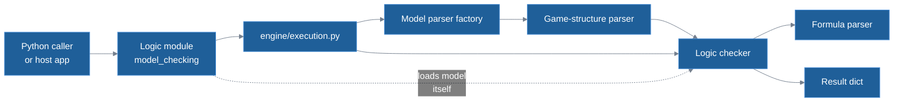
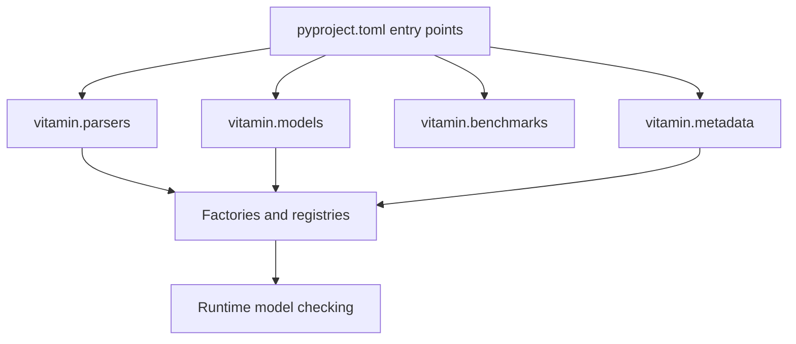
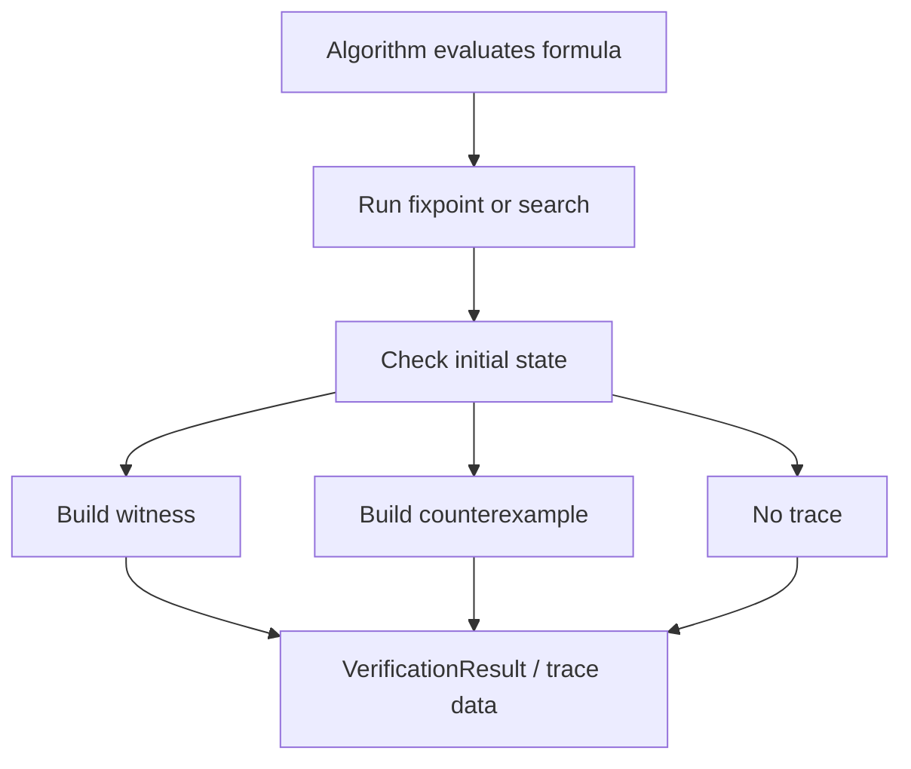

# Architecture

This page explains how the `model_checker` package is organized and where to
make changes safely. It focuses on the library itself; the README lists the
sibling projects: VMI (`vitamin-module-integrator`, which validates logic
bundles and integrates them here), Workbench and the benchmarks.

## Runtime Shape

The package separates model parsing, formula parsing, and verification
algorithms. A caller calls a logic module's `model_checking`; for most logics the
engine validates the input and loads the model, then the logic checker (the
checking code in `algorithms/explicit/<Logic>/`) parses the formula and computes
the result. LTL, NatATL, NatATLF and NatSL load the model themselves
([Engine Layer](#engine-layer)). The diagram shows this path:



The algorithms are explicit-state algorithms. They work over an in-memory model
and traverse the state space directly. That keeps the implementation readable
and makes witness and counterexample traces possible (only CTL builds them), but
large models can use a lot of memory.

## Package Layers

```text
model_checker/
├── algorithms/explicit/        # per-logic checking algorithms
│   └── shared/                 # result, trace and fixpoint helpers
├── automata/                   # vendored automata and game library (MIT), used by ATL*
├── contrib/                    # conformance checks and the bundle manifest schema (VMI)
├── engine/                     # shared execution pipeline
├── knowledge/                  # knowledge bundle builder and bundle file
├── models/                     # model parser factory (model_factory.py)
├── parsers/
│   ├── formulas/               # per-logic formula parsers
│   └── game_structures/        # one package per model type (8)
├── tests/                      # unit, integration, performance tests
├── utils/                      # error handling and shared utilities
├── api.py                      # public exports
├── api_integrated.py           # generated exports for VMI-integrated logics
├── discovery.py                # entry-point lookup
└── registries.py               # model type per logic, from vitamin.metadata
```

### Parser Layer

Model parsers read `.txt` model files and build in-memory game structures.
Current built-in model types include:

- `CGS` - standard concurrent game structures
- `BirelationalMatrix` - ICTL relation-labelled matrices (`0`/`R`/`P`/`P,R`)
- `BCGS` - CGS plus boolean `Preorder` (IATL)
- `costCGS` - CGS with action/transition costs
- `capCGS` - CGS with agent capacities
- `WalletCGS` - CGS with per-agent wallet balances (Wallet_ATL)
- `timedCGS` - costCGS plus clocks, clock constraints and invariants (TOL, TCTL);
  see [timedCGS sections](../reference/file_formats.md#timedcgs-sections)
- `ObstructionModel` - a graph whose edges demons disable (COTL)

The package registers 20 logic names in the `vitamin.parsers` entry points: 19 logics
plus `NatATL_Recall`, the recall variant of NatATL. `Wallet_ATL`, `TOL`, `TCTL`, `ICTL`
and `IATL` were integrated via VMI. See
[Logic Knowledge Base](../reference/logic_knowledge_base.md) for syntax details and
[File Formats](../reference/file_formats.md) for model file layout.

Formula parsers live under `parsers/formulas/<Logic>/` and parse formulas into
trees used by the algorithms. Most are built with PLY.

Two factories pick a parser by logic name: `FormulaParserFactory` for formulas
and `create_model_parser_for_logic` (`models/model_factory.py`) for model files.
The engine uses the model factory; most logic checkers get their formula parser
from `FormulaParserFactory`.

### Engine Layer

`execute_model_checking_with_parser` in `engine/execution.py` does the common
work around a model-checking call: it rejects an empty or blank formula and an
empty file name, loads the model with `create_model_parser_for_logic`, runs an
optional model check (CapATL uses one), runs the logic checker on the loaded
model and the formula text, adds `formula` and `model` to a result that has
neither them nor an `error` key, and turns exceptions into error dicts.

Logic modules reach it in two ways, or not at all:

- `create_model_checking_entry(logic, core)`, also in `engine/execution.py`,
  takes the logic checker's function `core` and returns
  `model_checking(formula, filename)`. ATL, ATLF, ATL_STAR, CapATL, COTL, IATL,
  ICTL, NatATL_Recall, OATL, OL, RABATL, RBATL, TCTL, TOL and Wallet_ATL build
  their entry point this way.
- CTL calls `execute_model_checking_with_parser` itself, because its
  `model_checking(formula, filename, preloaded_model=None, generate_trace=False)`
  also accepts a model already in memory and can return a trace. ATL_STAR also
  calls it for `synthesize_strategy`, which returns a winning strategy
  ([Strategy synthesis](../algorithms/atl_star.md#strategy-synthesis)).
- LTL `model_checking(formula, filename)`, NatATL `model_checking(formula,
  model_path)`, NatATLF `model_checking(formula, model)` and NatSL
  `model_checking(formula, model, mode="space")` do not call it and load the
  model themselves. In all four the second argument is a model file path.

A logic added by hand should use `create_model_checking_entry`, so that
validation and error handling match the other logics.

### Algorithm Layer

Each logic has a module under `algorithms/explicit/<Logic>/`. Most logic
checkers receive the parsed model from the engine, parse the formula with their
parser, evaluate the formula tree and return a result dict; the four logics
listed above load the model themselves.

Use shared helpers where possible:

- `format_model_checking_result`
- `verify_initial_state`
- `model_checker.utils.error_handler`
- trace helpers in `model_checker/algorithms/explicit/shared/trace_utils.py`

## Entry Points

`pyproject.toml` advertises built-in logic components through Python entry
points:

| Entry-point group | Purpose |
|---|---|
| `vitamin.parsers` | Logic name to formula parser class. |
| `vitamin.models` | Model type to game-structure parser class. |
| `vitamin.benchmarks` | Logic name to benchmark/model-checking callable. |
| `vitamin.metadata` | Logic name to metadata exposed by parser packages. |

VMI uses the same pattern when it integrates a logic bundle into this repo, so a
logic is registered through entry points, never by patching modules at runtime.
`registries.py` reads `vitamin.metadata` to find the model type of each logic,
which the model parser factory then loads. The diagram shows which groups feed
the factories:



## Trace Flow

CTL is the only logic with a `generate_trace` option. It returns a witness or a
counterexample for the outermost operator of the formula, or no trace; see
[Traces](../reference/logic_knowledge_base.md#traces-optional) and the
[CTL traces](../algorithms/ctl.md#traces).



Path and lasso helpers live in
`model_checker/algorithms/explicit/shared/trace_utils.py`. Keep trace
construction in these shared helpers so that other logics can reuse it.

## Adding Logic

The recommended path for adding a new logic is:

1. Build a VMI bundle.
2. Validate it with `vitamin-module-integrator`.
3. Let VMI integrate files and entry points into this repository.
4. Run this repository's tests and, where relevant, benchmarks from
   `vitamin-benchmark-model-checker`.

Maintainers can still add or change built-in logic manually; a new logic also
gets a page in [docs/algorithms/](../algorithms/index.md) with the sections
Model, Formula language, Semantic denotations, Theory vs implementation, Code
map and Tests, a section in the
[knowledge base](../reference/logic_knowledge_base.md) with its theory and
syntax, and a row in its syntax cards and logic comparison matrix.

## Testing And Performance

Tests live under `model_checker/tests/`:

- `unit/` for small parser/helper/algorithm pieces,
- `integration/` for real model files and public API behavior,
- `performance/` for time-bound regression checks.

The `vitamin-benchmark-model-checker` package provides pyperf benchmarks against
`vitamin.benchmarks` entry points. Use it when an algorithm change may affect
runtime, not as a replacement for correctness tests.

## Known Limits

- The current algorithms are explicit-state and can be memory-heavy.
- Symbolic model checking is not part of this package today.
- Only CTL builds traces ([Trace Flow](#trace-flow)).
- Workbench HTTP behavior lives in the sibling `vitamin-workbench` project, not
  in this repository.
